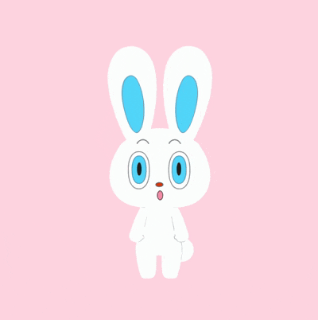

# vector-avator

**English summary:** vector-avator turns a single character illustration into a 2D vector avatar that moves with a 3D skeleton: gestures with generated arms, head turns up to ±30°, swinging ears and tails, automatic outlines, blinking, lip-sync and video export. It runs in the browser (TypeScript + Canvas 2D, no 3D model). A Claude Code skill (`.claude/skills/vector-avator/`) walks you through making your own character: Codex imagegen restyles the picture and draws two character sheets, then Fable 5.2 draws the fill-only SVG parts. The sample character "Kariusagi" is included. Documentation is in Japanese.

---

一枚のキャラ絵から、身振り手振りで動く 2D のベクターアバターを作るためのリポジトリです。



（音声なしの見本動画：[docs/media/kariusagi_demo.mp4](docs/media/kariusagi_demo.mp4)）

## できること

- **3D の骨格で動く 2D：** 部品はベクター（SVG のパス）で、骨格の動きに合わせて動きます。3D モデルは要りません。
- **腕は描かずに生成：** 上腕・前腕を長さの決まった 3D の骨として動かし、2D に投影して描きます。肘で曲がり、奥行きで太さが変わり、胴の前・後ろを自動で切り替えます。手は 4 種（開き・指差し・グー・手のひら）を差し替えます。
- **首振り ±30°：** 正面の絵 1 枚を、顔の球面に沿って変形させて向きを変えます。
- **揺れ物：** 耳・ツインテール・しっぽが、ばねの計算で遅れて揺れます。
- **自動輪郭線：** 部品は塗りだけで、線は描画時に引きます。手前の部品が同じか近い色の部品に重なる縁にだけ線が出ます。手描き風の線（強弱・揺らぎ・ボイル）も選べます。
- **表情と口パク：** 目（開・半目・閉）、口（無音・あ・い・う・え・お）、表情 4 種（通常・笑顔・驚き・困り）、自動まばたき、呼吸。テキストや音声から口パクを作れます。
- **動画の書き出し：** コマごとに時計を止めて撮るので、マシンの速さに関係なく同じ動画になります。

## 動かし方

必要なもの：Node 22、npm。

```bash
git clone https://github.com/grmchn/vector-avator.git
cd vector-avator
npm install
npm run dev
```

ブラウザで `http://localhost:5280/` を開くと、仮うさぎが表示されます。モーション、顔の向き、目・口・表情、線の設定を画面で変えられます。

動画の書き出し（開発サーバーの起動中。Playwright の Chromium と ffmpeg が必要）：

```bash
npx playwright install chromium
node tools/vector/record.mjs --out out/explain --motion explain
```

テストとビルド：`npm test`、`npm run build`。

## 自分のキャラを作る

このフォルダで [Claude Code](https://claude.com/claude-code) を開くと、Skill `vector-avator`（`.claude/skills/vector-avator/SKILL.md`）が読み込まれます。「この絵のキャラを追加して」のように頼むと、次の手順で進みます。

1. キャラの特徴の箇条書きを書く
2. 画風をそろえた正面の立ち姿を作る（Codex imagegen）
3. 360 度回転動画で角度の見本を作る（MiniMax H3、任意）
4. キャラクターシート 2 枚を作る（Codex imagegen）
5. 部品を、隠れる部分まで補完して描く（Fable 5.2 のサブエージェント）
6. 検査する
7. ビューアで動かして調整する
8. 動画と口パクを作る（TTS は任意）

| 道具 | 扱い |
|---|---|
| Claude Code ＋ Fable 5.2 | 必須（部品分け） |
| Codex CLI（imagegen） | 必須（画風の変換・シート） |
| Python 3.10 以上、resvg | 必須（生成・検査の道具） |
| Node 22、Playwright の Chromium、ffmpeg | 必須（ビューア・撮影） |
| MiniMax H3（ComfyUI） | 任意 |
| TTS | 任意 |

### 費用と時間の目安（実測）

仮うさぎを作ったときの実測です。2 体目以降のキャラで、待ち時間を含めて **1 キャラ 1〜1.5 時間**でした。人の作業は、キャラの特徴の箇条書きとレビューだけです。

| 段階 | 担当 | 時間 |
|---|---|---|
| キャラの補足 | Claude | 約 10 分 |
| 正面の立ち姿（2 回生成） | Codex imagegen | 約 4.7 分 |
| 角度の見本（任意） | MiniMax H3 | 約 7 分 |
| シート 2 枚 | Codex imagegen | 約 5 分 |
| 部品分け（47 部品）＋直し | Fable 5.2 | 約 16 分 ＋ 約 2.5 分 |
| 検査・確認・調整 | Claude | 約 20 分 |

公開前の確認として、このリポジトリの経緯を知らない別の Claude Code のエージェントに、この Skill と一枚絵だけを渡して、もう 1 体（63 部品）を作らせました。角度の見本（任意）を飛ばして **約 43 分**（Codex imagegen 4 回、Fable 5.2 は 1 回で約 24 分・約 28 万トークン、作り直し 0 回）で、ジェスチャーと口パクの動画まで作れました。

Codex imagegen は ChatGPT のプランの使用量の上限に達すると、数時間待つことがあります。トークン数と金額は計測していません。

## フォルダ構成

| 場所 | 内容 |
|---|---|
| `src/core/` | 骨格・ポーズ・モーション・顔・まばたき・口パク（描画に依存しない） |
| `src/renderers/vector/` | 描画エンジン（腕の生成、首振り、揺れ物、自動輪郭線） |
| `src/vviewer/` | ビューア |
| `data/motions/` | モーション（手付けのジェスチャー、ダンス、AI 生成のモーション） |
| `public/characters/usagi/vector/` | 見本キャラ：部品（`vector.json`）と参照画像（`ref/`） |
| `inputs/kariusagi/` | 見本キャラの元の絵 |
| `tools/vector/` | シートの生成、部品の検査、動画の書き出し |
| `tools/lipsync/` | 口パクの作成 |
| `.claude/skills/vector-avator/` | Skill（手順書と部品仕様） |

## このリポジトリについて

- 開発用のリポジトリから切り出した**スナップショット**です。更新は不定期です。
- Issue と Pull Request を歓迎します。このリポジトリで自由に育ててください。よい変更は、開発用のリポジトリにも取り込みます（詳しくは [CONTRIBUTING.md](CONTRIBUTING.md)）。

## ライセンス

- **コード：** [MIT License](LICENSE)
- **見本キャラ「仮うさぎ」の素材：** 動作確認用の見本です。個人の方は、改変・商用を含め自由に使えます。企業の商用利用は、X の [@grmchn4ai](https://x.com/grmchn4ai) まで DM でご連絡ください。詳しくは [ASSETS_LICENSE.md](ASSETS_LICENSE.md)。
- **モーションデータ：** `data/motions/ai/` は、NVIDIA の Kimodo と MotionBricks で生成したものです（出所は各ファイルの `source`）。
